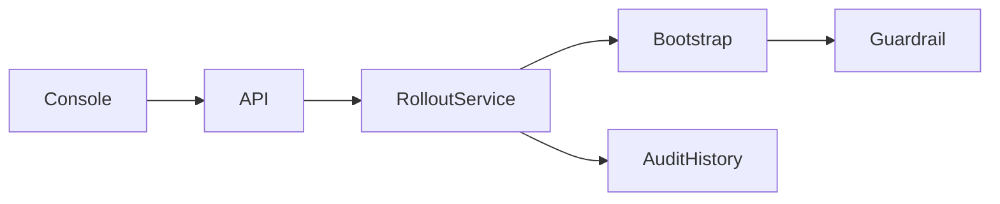

# Signal Ops

> Decisões de rollout apoiadas em evidência estatística

Um rollout não deveria avançar apenas porque uma média pontual parece aceitável; incerteza e reprodutibilidade fazem parte da decisão.

Projeto de portfólio executável, com dados sintéticos. Não representa um sistema em produção nem resultados de clientes.

## O que está implementado

Bootstrap não paramétrico; intervalo percentil de 95%; guardrail configurável de regressão média; decisões promote/hold/rollback/insufficient_data; p95 descritivo; histórico por tenant; repetição idempotente e console operacional.

## Executar em cinco minutos

Requer Python 3.12 ou 3.13. Execute dentro desta pasta:

```powershell
python -m venv .venv
.venv\Scripts\Activate.ps1
python -m pip install -r requirements.txt
python -m uvicorn app.main:app --port 8103
```

Linux/macOS: ative com `source .venv/bin/activate`.
Abra http://localhost:8103 para a console e http://localhost:8103/docs para o contrato OpenAPI.
As chaves locais são `local-alpha` e `local-beta`, enviadas em `X-API-Key`.

### Demonstração

Execute a amostra de regressão na console: a recomendação é rollback. Troque candidate_ms para valores próximos de 100 e use outra chave: a recomendação deve mudar para promote. Inspecione o histórico e o intervalo usado na decisão.

### Testes

```bash
python -m pytest -q
```

Os testes usam bancos temporários. Verificam isolamento, autenticação, regras de domínio e cenários de falha.

### Docker

```bash
docker build -t signal-ops .
docker run --rm -p 8103:8103 signal-ops
```

O container usa usuário sem privilégios. O banco é efêmero nesse comando; monte um volume e configure DATABASE_PATH para persistência.

## Arquitetura



`app/main.py` define contratos HTTP; `app/service.py` contém casos de uso e transações;
o módulo de domínio contém o algoritmo; `app/platform.py` concentra autenticação e conexão.

Leia [decisões e tradeoffs](docs/architecture.md), [modelo e limites](docs/model-card.md),
[operação](docs/runbook.md) e [segurança](SECURITY.md).

## Limites conhecidos

É um motor consultivo de inferência estatística, não um controlador de Kubernetes nem um LLM. Pressupõe amostras representativas e aproximadamente independentes; não corrige viés, autocorrelação, testes repetidos ou sazonalidade. O p95 é descritivo e não determina a decisão. Não há ação automática em produção.

## Próximos incrementos

Ingerir métricas reais via OpenTelemetry/Prometheus; testar cobertura empírica do intervalo; introduzir block bootstrap para séries temporais, guardrails de erros e custo, política de aprovação humana e integração progressiva com controladores de rollout.

## Verificação em navegador

O job `browser` da CI executa fluxos em Chromium, verifica a versão de 390 px e publica capturas como artifact `dashboard-screenshots`. Execute `npm install` em `ui/`, `npx playwright install chromium` e `node ui/smoke.cjs` na raiz com a API em localhost:8000 para repetir.
